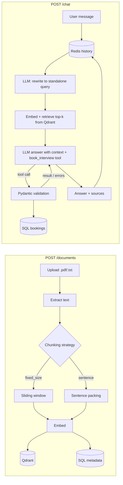

# PalmMind RAG Backend

A FastAPI backend with two REST APIs:

1. **Document Ingestion API**: upload `.pdf` / `.txt`, extract text, chunk it with one of **two selectable strategies**, embed, store vectors in **Qdrant** and metadata in **SQL** (SQLite locally, PostgreSQL in Docker).
2. **Conversational RAG API**: a **custom** retrieval-augmented pipeline (no `RetrievalQAChain`, no LangChain chains) with **Redis chat memory**, **multi-turn query rewriting**, and **LLM-driven interview booking** (name, email, date, time) persisted to SQL.

No FAISS/Chroma, no UI. Fully typed (`mypy --strict` clean), linted with `ruff`, with tests that run offline.

---

## Requirements checklist

| Requirement | Where |
|---|---|
| Upload `.pdf` / `.txt` | `POST /api/v1/documents` · `app/services/extraction.py` |
| Two selectable chunking strategies | `fixed_size` / `sentence` · `app/services/chunking.py` |
| Embeddings → vector DB (Qdrant) | `app/services/embeddings.py`, `app/services/vector_store.py` |
| Metadata in SQL | `documents`, `document_chunks` tables · `app/db/models.py` |
| Custom RAG (no RetrievalQAChain) | `app/services/rag.py` |
| Redis chat memory | `app/services/memory.py` |
| Multi-turn queries | history-aware query rewriting + history in the prompt |
| Interview booking via LLM | OpenAI-style tool calling · `app/services/booking.py` |
| Store booking info | `bookings` table · `GET /api/v1/bookings` |
| Typing, modular, industry standards | `mypy --strict`, `ruff`, layered architecture, DI, tests |

---

## Architecture



```
app/
├── main.py               # app factory, lifespan, error handlers
├── container.py          # composition root (dependency wiring)
├── core/                 # settings, logging, domain exceptions
├── db/                   # SQLAlchemy 2.0 async models + session
├── schemas/              # Pydantic request/response models
├── api/routes/           # thin HTTP layer: documents, chat, bookings
└── services/             # business logic, framework-independent
    ├── extraction.py     # pdf/txt → normalized text
    ├── chunking.py       # FixedSizeChunker, SentenceChunker
    ├── embeddings.py     # OpenAI / fastembed behind an Embedder protocol
    ├── vector_store.py   # Qdrant wrapper
    ├── memory.py         # Redis chat memory
    ├── llm.py            # OpenAI-compatible chat + tool calls
    ├── ingestion.py      # ingestion pipeline
    ├── booking.py        # tool schema + persistence
    └── rag.py            # the custom RAG pipeline
```

Routes only translate HTTP ↔ services. Services depend on **protocols** (`Embedder`, `LLMClient`), so providers can be swapped and tests inject deterministic fakes.

---

## Design decisions

### Chunking strategies

| Strategy | How it works | Best for |
|---|---|---|
| `fixed_size` | Sliding character window of `chunk_size` with `chunk_overlap`, edges snapped to whitespace so words are never cut. | Uniform, unstructured text; predictable chunk sizes. |
| `sentence` (default) | Splits into paragraphs → sentences, packs whole sentences up to `chunk_size`, carries trailing sentences (≤ `chunk_overlap` chars) into the next chunk. Oversized sentences fall back to hard wrapping. | Prose and FAQs; each chunk stays semantically coherent, which improves retrieval precision. |

Both are selectable per upload (`chunking_strategy`, `chunk_size`, `chunk_overlap` form fields), and the choice is stored in the document's metadata.

### Custom RAG pipeline (`app/services/rag.py`)

1. **Load history** for the `session_id` from Redis.
2. **Rewrite** the latest message into a standalone query using recent history, so a follow-up like *"what do they offer?"* retrieves the right chunks. Skipped on the first turn.
3. **Retrieve** top-k chunks from Qdrant (cosine similarity, configurable score threshold).
4. **Generate** with a system prompt containing numbered context (`[1]`, `[2]`, …) for citations, an instruction to admit when the context doesn't contain the answer, and the `book_interview` tool.
5. **Booking**: if the LLM calls the tool, arguments are validated with Pydantic (`EmailStr`, real date/time, date not in the past). Valid → saved, and the confirmation is sent back to the LLM to phrase the reply. Invalid → the validation errors are sent back as the tool result, so the LLM asks the user to fix them. The LLM never writes to the DB directly.
6. **Persist** the user/assistant exchange to Redis.

The response includes the `standalone_query` and `sources` so retrieval is transparent and debuggable.

### Memory (Redis)

One list per session (`chat:{session_id}:messages`), written in a single transaction (`RPUSH` + `LTRIM` + `EXPIRE`): bounded to the last N turns and expiring after 24h by default, so memory can't grow unbounded.

### Consistency

Vectors are written before the SQL commit; if the commit fails, the document's vectors are deleted. Deleting a document removes both its vectors and metadata.

### Providers

The LLM client speaks the OpenAI chat-completions protocol, so it works with **OpenAI, Groq, Ollama, or any compatible endpoint** through `LLM_BASE_URL`. Embeddings use OpenAI or **local `fastembed`** (no API key needed).

---

## Running it

### Option 1: Docker (recommended)

```bash
cp .env.example .env        # add your Groq or OpenAI key
docker compose up --build
```

Open **http://localhost:8000/docs** for interactive Swagger docs.

### Option 2: Local Python

Requires Python 3.11+ plus Redis and Qdrant running (e.g. `docker compose up redis qdrant -d`).

```bash
python -m venv .venv
source .venv/bin/activate          # Windows: .venv\Scripts\activate
pip install -e ".[dev,local]"
cp .env.example .env               # add your key
uvicorn app.main:app --reload
```

Tip: setting `QDRANT_URL=` (empty) runs Qdrant in-memory, which is handy for a quick try without the Qdrant container.

---

## API examples

**Upload a document**

```bash
curl -F "file=@samples/company_handbook.txt" \
     -F "chunking_strategy=sentence" \
     -F "chunk_size=500" -F "chunk_overlap=80" \
     http://localhost:8000/api/v1/documents
```

**Ask a question** (omit `session_id` to start; reuse the returned one for follow-ups)

```bash
curl -H "Content-Type: application/json" \
     -d '{"message": "What does the hiring process look like?"}' \
     http://localhost:8000/api/v1/chat
```

**Multi-turn booking**

```text
User: I'd like to book an interview.
Bot:  Sure! Could you share your full name, email, and preferred date and time?
User: Krishna Acharya, krishna@example.com
Bot:  Thanks, Krishna. What date and time work for you?
User: Next Monday at 2pm
Bot:  Done! Your interview is booked for Monday, 2026-10-19 at 14:00 (krishna@example.com).
```

The final response contains a `booking` object, and the booking is listed at `GET /api/v1/bookings`.

| Method | Endpoint | Description |
|---|---|---|
| `POST` | `/api/v1/documents` | Upload and index a file |
| `GET` | `/api/v1/documents` | List documents (paginated) |
| `GET` | `/api/v1/documents/{id}` | Document metadata |
| `DELETE` | `/api/v1/documents/{id}` | Delete document + vectors |
| `POST` | `/api/v1/chat` | Conversational RAG + booking |
| `GET` | `/api/v1/chat/{session_id}/history` | Session history from Redis |
| `DELETE` | `/api/v1/chat/{session_id}` | Clear session memory |
| `GET` | `/api/v1/bookings` | List bookings |
| `GET` | `/health` | Health check |

---

## Quality

```bash
pytest            # 16 tests, offline: in-memory Qdrant, fakeredis, scripted LLM
ruff check .      # lint
mypy app          # strict type checking
```

Tests cover both chunking strategies, upload validation (type, empty, blank PDF, overlap), retrieval, multi-turn rewriting and memory, valid bookings, and invalid bookings being reported back to the LLM instead of saved.

---

## Possible extensions

- Alembic migrations (tables are currently created at startup).
- Hybrid search (BM25 + vectors) and a reranker.
- Booking conflict detection and email confirmations.
- Streaming responses (SSE) and authentication.

---

**Author:** Krishna Acharya · krish9805273139@gmail.com
